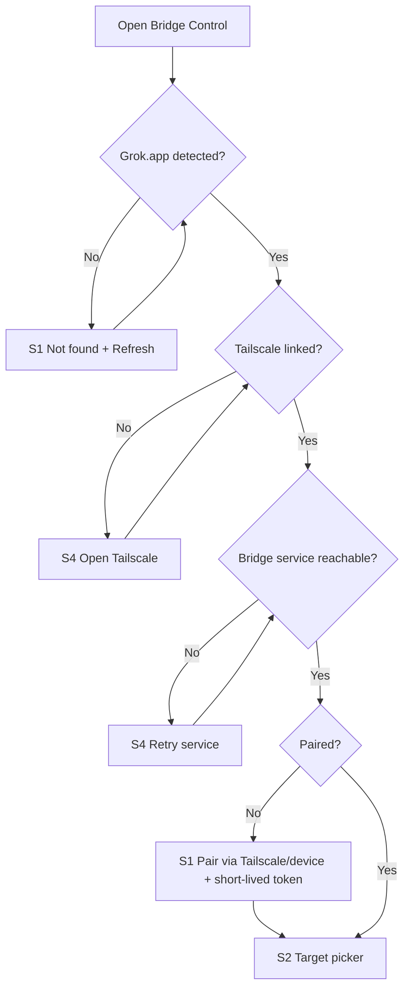
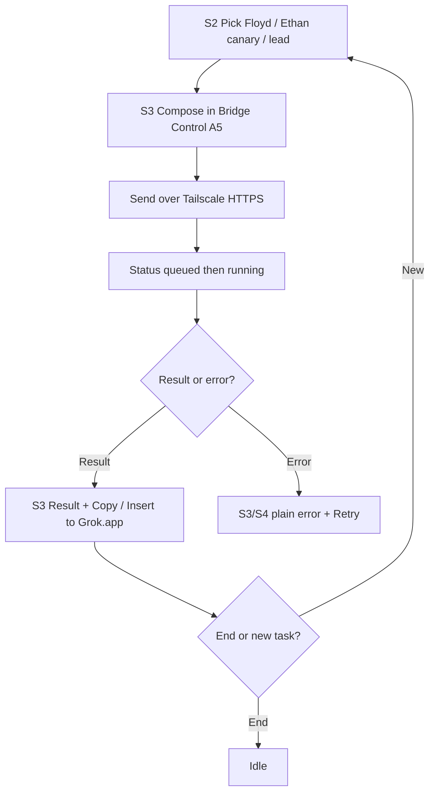
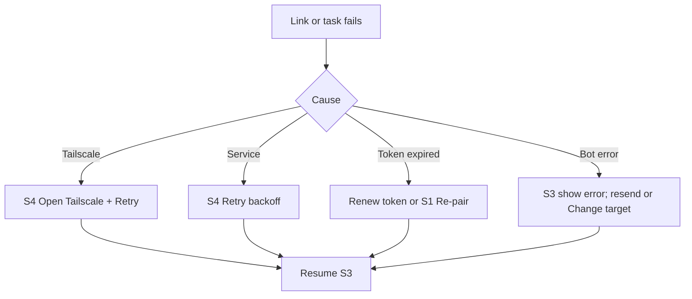

# Flows MVP v0.1 — Benchlink (A5-aligned)

**Owner:** Amir · Design Lead · **Companion:** `wireframes-mvp-v0.1.md`

## Connect / Pair (D2–D4, A3)

## Staff task happy path (D1 + A5 + S2)

## Error recovery

