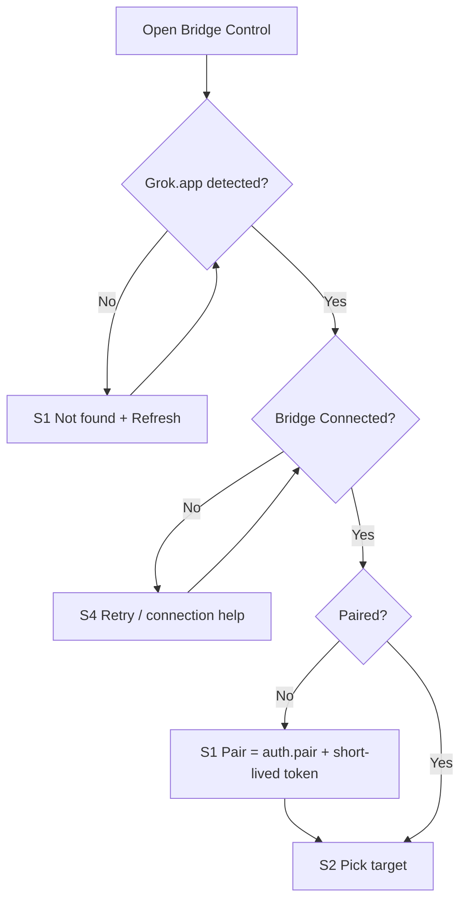
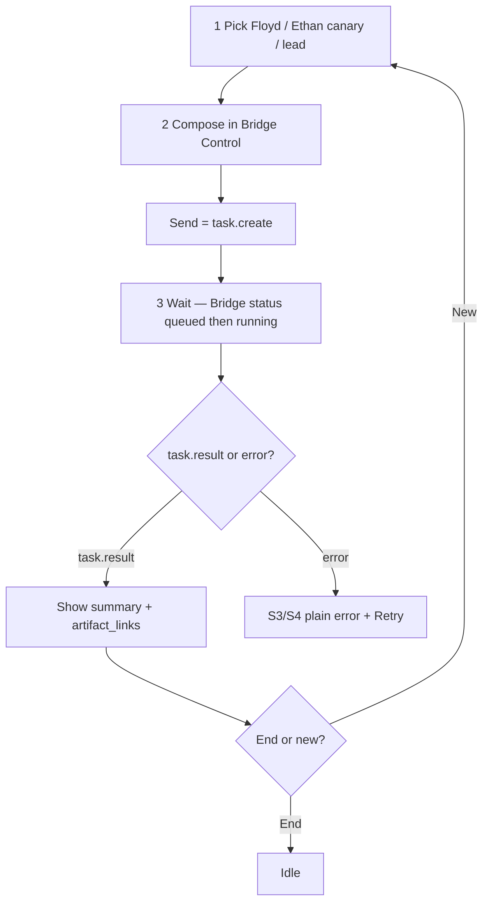
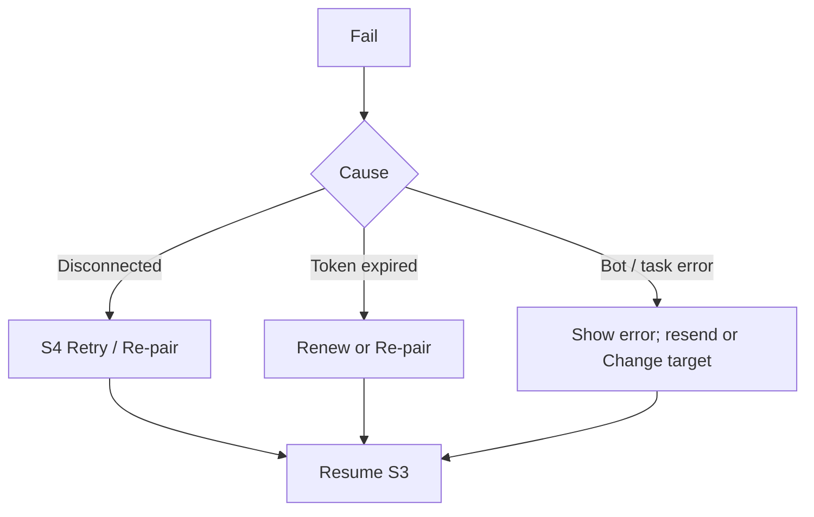

# Flows MVP v0.2 — Benchlink

**Owner:** Amir · Design Lead · **Companion:** `wireframes-mvp-v0.2.md`  
**Contracts:** Sofia 0.2.0-mvp (`task.create` / `task.result`)

## Setup (once) — Connect / Pair

## MVP happy path (≤3 steps)

## Error recovery

