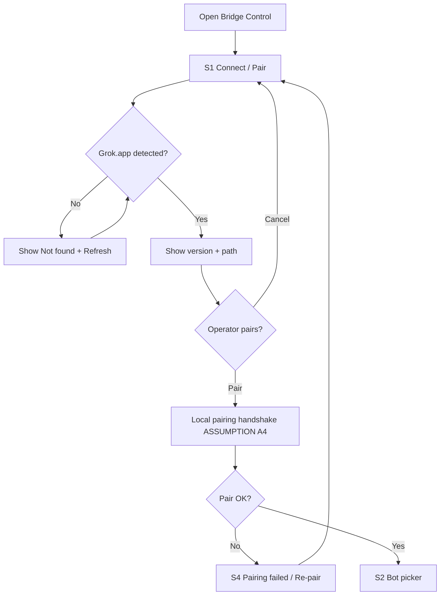
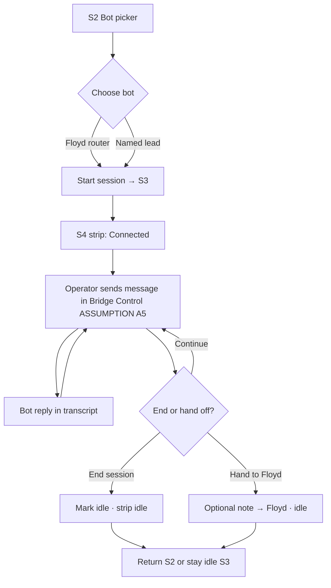
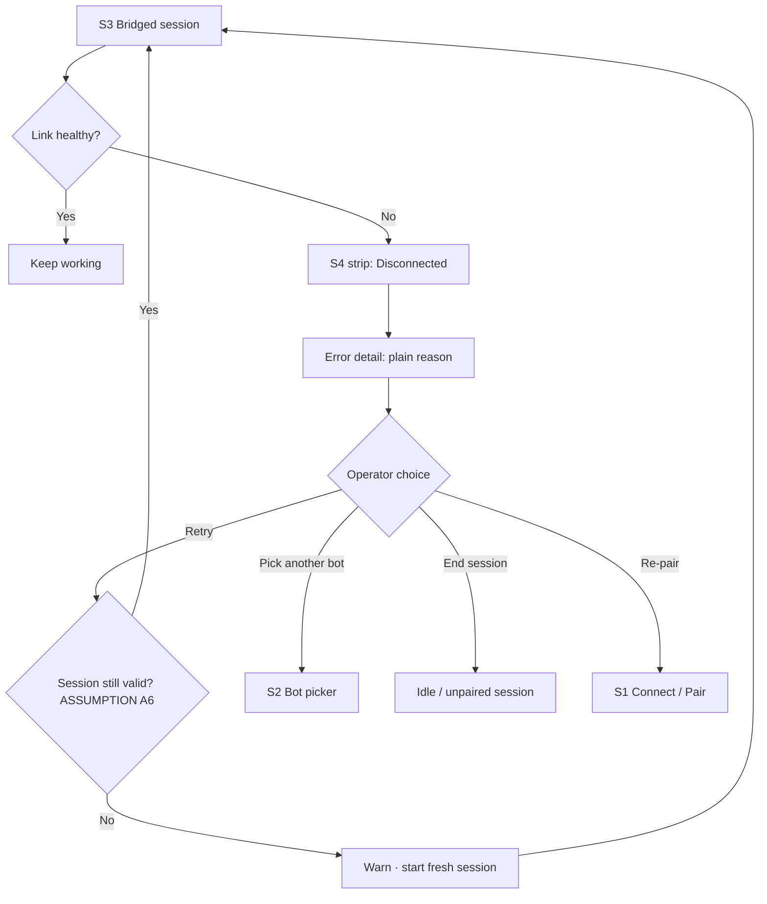

# Flows MVP v0 — Grok-App ↔ Floyd Bridge

**Owner:** Amir · Design Lead  
**Date:** 2026-11-05 (America/Indianapolis)  
**Companion:** `wireframes-mvp-v0.md` · `../SSoT.md`

> Flows are UX-level. Transport, auth, and runtime are **ASSUMPTIONS** (see wireframe pack A4/A9/A10). No API contracts.

---

## Connect / Pair

---

## Bridged session

---

## Error recovery

---

## Notes for implementers (non-contract)

- Keep status strip (S4) visible across S1–S3 whenever connection state matters.
- Error copy talks about the **bridge cable**, not Grok Build provider settings.
- Do not encode Tailscale vs HTTP vs local protocol in the UI until Sofia locks transport (A9).
